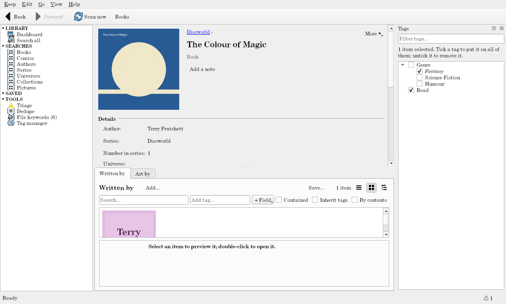

# Item pages

Double-click an item (or press Enter) for its page; for kinds that open their file on double-click (songs, plain files), Ctrl+Enter opens the page instead. **Back** returns to where you were.

## What's on a page

The middle of a page has the header and, below it, what the item holds or links to, as tabs. Its details (**Details**, **Extra fields**, **Files**, **From the file**) are in the **Details** tab beside **Tags** on the right, so the tabs start right under the header and get the room. Drag the divider between them to give the header more; it stays there while the page is open.

- **The header:** its thumbnail, title, and kind, with the [badges](tags.md#tag-icons) of its tags beside the title. Above the title, **breadcrumbs** show what holds it (`Discworld ›`), each opening that item's page. Under it, the item's [note](notes.md): its text, with **Show more** for all of it (headings, tables, pictures) and **Open note** for a note file; an item without a note whose own file is Markdown shows a [glimpse of that file](notes.md#an-items-own-markdown-file) instead, with **Open file**; an item without a note file has **Add a note**, or ✎ to edit the note [typed in Tagalot](notes.md#typing-a-note-in-tagalot).
- **Details** (in the Details tab): its fields, each name above its value. Fields you can change show a ✎ when you point at them.
- **Extra fields** (in the Details tab): fields of your own for this one item (a name and a value), searchable like any text. Those from the item's [note](notes.md) are marked "• from the note".
- **Galleries:** pictures that belong to it (a movie's screenshots, an album's scans), as thumbnails under the header, or as tabs below it when the page has tabs (see [Galleries](#galleries) below).
- **Files** (in the Details tab): each file it links, with its folder and size, and whether it's **offline** or **missing**. Right-click a file for Open file, Show in file manager, and Open with.
- **From the file** (in the Details tab): the keywords its files gave and what became of each (see [File keywords](file-keywords.md)).
- **Related items:** a movie's cast, a book's writers, a paper's authors in order, what a paper cites: each a small search of its own, with **Add…** to add one by hand and **Remove from …** on its items' menus. What you add or remove by hand stays that way through later scans.
- **Contents:** for an item that holds others (an artist, an album, a series), a search of what it holds, with its own filter bar. An item that can hold several kinds of thing has a tab for each, with how many it holds: an artist's page has **Albums (2)** and **Songs (21)**, the songs including those in its albums. Kinds it holds none of have no tab. **Show in search** lists all of it at once in Search all. Hide kinds of files with the chips above a tab's list (see [Hiding kinds of items](searching.md#hiding-kinds-of-items)); the tab then says how many show, like **Books (9 of 16)**.
- **Tabs:** related items, contents, and galleries share the area below the header as tabs, galleries last (**Scans (3)**). Tagging applies to what you've selected in the tab shown. The next page of the same kind opens on the tab you used last.
- **More ▾:** Open file, Show in file manager, Open with, Open note (when it has one), Save as note… (when the [notes folder](notes.md#save-as-note) takes new notes), Re-read from file, Look up online and Write to file… (when the keep offers them), and the theme's commands also appear as buttons.

Tagging on a page applies to the page's item, or to the items selected in its contents.

## The Details tab

**Details** sits beside **Tags** on the right; click either tab to switch, and the one you chose stays chosen next time. On an item's page it shows that item's details. In a search, it shows the selected item's, with its name at the top (click it to open its page), so you can read and change an item's fields without leaving the search; with several selected, it says how many. Drag the panel's edge to make it wider; it keeps its width. **View → Details** hides or shows it.

## Galleries

Some kinds of item have a gallery of pictures on their page:

| Item | Gallery | Pictures from |
| --- | --- | --- |
| Movie | Screenshots | `Screenshots`, `Screens`, or `Stills` in its folder (and the theme's own: `extrafanart`, `-fanart.jpg`…) |
| Album | Scans | `Scans`, `Artwork`, `Covers`, or `Booklet` in its folder |
| 2D assets artist | Previews | `Previews`, `Preview`, or `Samples` in its folder |
| Person (movies), music artist | Photos | the [notes folder](notes.md#the-notes-folder) |
| Book | Covers | the [notes folder](notes.md#the-notes-folder) |
| Book | Pictures | everything in its own folder, at any depth, when no other book or comic is in it (a story's renders) |

- **Folders:** every picture in such a subfolder of the item's folder counts, however deep (`Screenshots/Disc 2/Deleted/…`), and so does an archive named like one beside it (`Screens.zip`, `Booklet.rar`). Names are matched ignoring case. A folder that several items share (loose movies side by side) gives none of them a gallery, since Tagalot can't tell whose pictures they are.
- **The notes folder:** a folder or archive named like an item's note, beside it (`Notes/Actors/Sigourney Weaver/`, `Sigourney Weaver.zip`), is that item's gallery. It follows the note: if the note stops matching the item, its gallery goes too.
- **On the page:** pictures directly in the gallery's folder come first, then a group for each subfolder, then one for each archive (`.zip`, `.7z`, `.rar`, `.cbz`…), whose pictures Tagalot reads without unpacking it. Double-click a picture to open it; one from an archive opens from a temporary copy, so the archive is never changed. An archive Tagalot can't read says why; a `.rar` needs unrar, 7-Zip, or bsdtar installed to look inside. A gallery with no pictures isn't shown.
- **Hiding file types:** a gallery shown as a tab with pictures of several types has chips above it (`JPG 2`, `ZIP 1`), like a list's (see [Hiding kinds of items](searching.md#hiding-kinds-of-items)). Hiding `ZIP` hides each archive's group; a group left with nothing goes too, and the tab says how many show, like **Scans (2 of 3)**. Each kind of item remembers what its gallery hides.
- **Scans keep it up to date:** pictures you add or delete come and go at the next scan. A picture you linked to the item by hand stays.

## Its picture

An item's picture (on its page, its card, and its row) is chosen in this order:

1. **One you chose:** **More ▾ → Set picture…** picks a picture file in a watched folder (for an author, a series, anything), and right-clicking a picture file on a page offers **Use as its picture**. **More ▾ → Use the usual picture** forgets your choice. Both are steps you can undo.
2. **Its note's:** a `cover` (or `image`) key in the item's [note](notes.md#what-a-note-gives), or, in the notes folder, a picture named like the note beside it.
3. **The usual one:** what the kind of item shows (a book's cover, a movie's poster, an album's art).
4. **Its gallery's first picture**, when there's no usual one (an author's photos), before a title card or icon.

Point at the picture on the page to see where it comes from ("Its picture, chosen by you: …").

## Changing details

Double-click a value (or click its ✎) to edit it: **Enter** saves, **Esc** cancels. Numbers, dates (`2024-05-01`), and times are checked as you save, and a value that doesn't fit stays in the box with the reason. Yes/no fields are a checkbox. A **Rating** is five stars: click a star to rate (its left half for half a star), and click the rating it has to clear it. Some fields come from the file and can't be edited (a file's size, an image's width).

**Fields of your own** (added in [Keep configuration](keep-configuration.md#fields)) follow the theme's under Details and edit the same way. Text you type in them is found by the search box.

**Make it a field…**, on the arrow beside an Extra field's ×, turns that Extra field into a field of your own, in every item that has it. It asks for the label, the kind, and so on, as Keep configuration's **Add field…** does, and which kinds of item it's for: the item's own, and others that have the same Extra field. Before anything changes it says how many values fit ("212 items: 205 read as whole numbers and move; 7 don't…") and lists those that don't: they stay Extra fields, for you to fix. Values from a note stay marked as the note's. **Edit → Undo** reverses it.

**Rating anything:** kinds of items that have no rating (people, collections, a folder of assets) can have one: right-click their view in the navigation and tick **Rate …** (**Rate Collections**). Their pages then show five stars, set and cleared as any rating, and their lists and cards show them too. Untick it to stop (it asks first; the ratings become Extra fields, and **Edit → Undo** brings them back).

**Turn back into an Extra field**, on the arrow (▾) beside one of your fields, does the reverse, in every item, at any time. **Edit → Undo** reverses that too.

**A value you edited is yours:** it's marked "• edited", and scans never change it. Every edit is one step you can undo.

**Fields that name other items** (a book's **Series**, **Universe**, **Collections**, and **Author**; a comic's **Writer** and **Artist**; an album's **Artist**) edit the same way, and move the item: type `Witches` as a book's series and it leaves its old series for **Witches** (made if there isn't one). Separate several names with commas (`Cosmere, Favourites`), or with `;` when a name has a comma in it (`Pratchett, Terry; Gaiman, Neil`). Scans keep what you chose, even though the file still says otherwise. A book in a series takes its **Universe** from the series: change it on the series' page, and its books follow.

## Re-reading files

**Re-read from file** (right-click an item, or More ▾) reads its files again now, without a full scan: useful after editing a file's tags elsewhere. Values you edited stay. **Re-read from file, replacing my edits…** lets the files' values win (it asks first, and Edit → Undo puts your edits back).

## Opening files

- **Open file** opens an item's file with your computer's program for it (an album's folder opens as a folder).
- **Show in file manager** opens its folder with the file selected, and the status bar says which file. If the file isn't where Tagalot expects it, the status bar says so instead: scan again, or check the watched folder's path in Keep configuration.
- **File manager ▸ Use a different file manager…** picks the program Show in … uses from now on, in every keep, such as Directory Opus when it isn't your computer's default. The menu then says **Show in Directory Opus**. **Use the system file manager** goes back. It's saved in your [settings](../reference/keep-files.md#settingstoml), where you can change its command, for example to `{dir}` if your file manager can't select a file.
- **Open with ▸ Choose a program…** picks a program just this once; **Always open .ext files with…** makes it the program Tagalot uses for that kind of file (saved in your [settings](../reference/keep-files.md#settingstoml); **Stop using…** undoes that).

If the file can't be opened, the status bar says why: it's missing, its folder is offline, or the folder has no path on this computer.

**A file inside an archive** (a font in a zip, when the keep reads inside its archives) shows as the archive, then its path inside it: `Aurora Studio/pack.zip › fonts/Regular.ttf`. **Open file** and **Open with** open a copy taken out of the archive (the archive isn't changed, and neither is anything you save in the copy), and **Show the archive in file manager** shows the archive. **Hide inside its archive** stops reading it; an archive's own row has **Choose what to read inside…**, **Read everything inside**, and **Stop reading inside** (see [Reading inside archives](keeps-and-folders.md#reading-inside-archives)).
