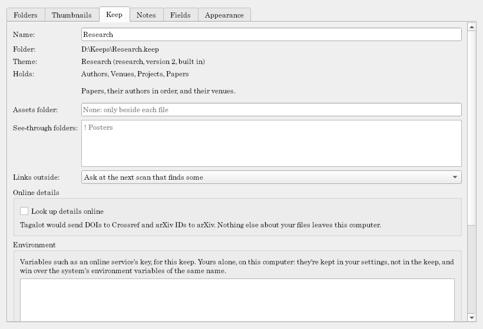
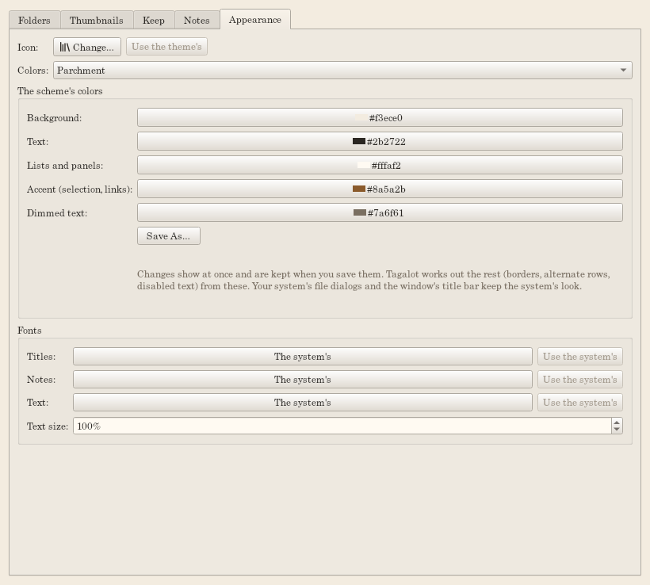

# Keep configuration

**Keep → Configure keep…** opens a window of six tabs. Every change is saved as you make it (to `keep.toml`, or to your own settings for **On this computer** and **In all your keeps**); a value that can't be used is explained under the form.

## Folders

The folders the keep watches, each with its state (online, offline, not watched, not scanned yet). For the selected folder:

- **Name** and **Folder** (its path, exactly as you type it; a network share keeps its form).
- **On this computer:** a different path for this computer only (see [Keeps and folders](keeps-and-folders.md#on-this-computer)), with Browse and Clear.
- **Skip:** patterns for files to leave out, one per line, each with an optional note after ` # `. See [Skipping files](keeps-and-folders.md#skipping-files).
- **Write back:** "Let Write to file… change files in this folder", off unless you turn it on (it asks first). See [Writing to files](write-to-file.md).
- **Assets folder:** where its Markdown files' pictures and links are looked for when they aren't beside the file (an attachments folder): a folder from the top of this folder, or from each file's own folder when it starts with `./`. Empty uses the keep's (shown greyed). A file's own `assets` key comes first. See [Assets folders](../themes/books.md#assets-folders).
- **Status:** how many files and folders it knows, how many are offline or missing, the last scan, and the last error.
- **Theme options for this folder:** the theme's settings for this folder only, over the keep's (tick one to override it here).
- **Scan now** (this folder), **Stop watching** / **Watch again**, and **Remove…**.

**Add folder…** watches another folder. Adding a folder, watching one again, or changing a path or Skip patterns offers to scan.

## Thumbnails

- **Largest size:** the theme's size, or one of the keep's own (16 to 2048 pixels). Bigger looks sharper when you zoom in, and takes more space. Thumbnails at the old size are made again as they're shown.
- **Make new and changed items' thumbnails after each scan:** on by default. Turn it off for a huge keep on a slow share; thumbnails are then made only as pages show them.
- **Stored:** how many thumbnails are stored and their size, with **Clear…** (also **Keep → Clear thumbnail cache…**). They're made again as you browse.

## Keep

- **Name** (editable), the keep's folder, its theme (and its version, and whether it's built in), and what kinds of items it holds.
- **Assets folder:** the assets folder of every watched folder that doesn't name its own (see Folders above). Covers are looked for there at the next scan; notes' pictures and links at once.
- **See-through folders:** folder names, one per line, such as `! Posters`. A folder with one of these names is never an item, but nothing in it is ignored: its files count as its parent folder's. A poster in `Heat (1995)/! Posters` is Heat's poster, and pictures in `3rd Birthday/! Posters` are among the `3rd Birthday` Folder's. Names match exactly, ignoring case. They're saved when you leave the box, and the next scan reads the keep's files again. If the change would remove Folders you've tagged, Tagalot asks first, since their tags go with them.
- **Links outside:** what to do with symbolic links and shortcuts that lead outside every watched folder: **Include them** (what they lead to is read as if it were where the link is), **Leave them out**, or **Ask at the next scan that finds some** (the first scan that finds such links asks, and its answer shows here). The next scan applies it.
- **Theme options:** the theme's settings for this keep, each with **Default**. They apply at the next scan, which reads the affected files again. The built-in ones: 2D assets' **Artist folder level** and books' **Source folder level** (see each [theme](../themes/README.md)).
- **Online details** (themes that look things up): **Look up details online**, **Find items by** (IDs only, or titles too, for services that can find items by title), what it would send, and which services wait for a token. See [Online details](online-details.md).
- **Environment:** variables for this keep, such as an online service's key (`TAGALOT_TMDB_TOKEN`), yours alone: kept in your settings on this computer, not in the keep. **Set…** gives one a value (typed hidden), **Add…** adds one by name, **Remove** forgets it, and **Show values** shows them. The variables the keep's services need are listed even before they're set. See [Online details](online-details.md#services-that-need-a-token).
- **Search inside documents** (themes with documents): **Off**, **Words**, or **Substrings**, what's stored, and **Clear contents text…**. See [Searching inside documents](search-inside-documents.md).

## Notes

**Notes folder:** where notes for items without a folder of their own live (see [The notes folder](notes.md#the-notes-folder)). **Choose…** picks it: a folder inside a watched folder is used in place; one outside every watched folder is watched for notes only, after asking. **None** stops using it. Either applies at the next scan, which offers to start.

**Let Save as note… add new notes to this folder:** off by default. Turn it on (it asks first) to let **Save as note…** on an item write its [typed note](notes.md#save-as-note) as a new file here. That's all it lets Tagalot do: add new notes, never change or replace a file, even when the watched folder the notes folder is in doesn't allow **Write to file…**. Choosing another notes folder turns it off.

**Let Write to file… change notes' front matter here:** off by default. Turn it on (it asks first) to let [Write to file…](write-to-file.md) on an item write its tags and the fields you edited into its note here, after a preview and with a backup. It changes only notes' front matter, and is separate from the box above. Choosing another notes folder turns it off too.

**New notes go** in a folder for each kind of item (`Actors/Keanu Reeves.md`), or all in the notes folder, typed by `tagalot-type`.

**Keys to ignore in notes:** front-matter keys that never become Extra fields, one per line. **In this keep** is saved with the keep; **In all your keeps** is saved for you on this computer; **Always** lists the built-in ones. Each list is saved when you leave its box and applies at the next scan. See [Notes](notes.md#keys-to-ignore).

**Keys to read as fields:** front-matter keys read as one of the item's fields rather than as Extra fields, one `key = field` a line (`synopsis = Description`), naming the field by its name or label. **In this keep** is saved with the keep and wins over **In all your keeps** for the same key. Saved when you leave the box; applies at the next scan. See [Notes](notes.md#keys-to-read-as-fields).

## Fields

Fields of your own for a kind of item, beside the ones its theme gives it: a book's **Pages read**, an album's **Bought**. They're saved with the keep, so they go where it goes. You fill them in on an item's page, where they follow the theme's under **Details** (see [Changing details](item-pages.md#changing-details)).

**Add field…** asks for:

- **Type:** the kind of item it belongs to.
- **Label:** its name on pages. It can't be the name of one of the theme's fields; to fill one of those from your notes, add a key to **Keys to read as fields** (Notes tab) instead.
- **Kind:** text, a whole number (integer), a number, a date, yes/no, a link (a web address that opens in your browser), or a rating (five stars, in half stars). A kind of item has one rating at most, and none of yours when its theme rates it already.
- **Searched:** by its words, by a range, by picking values, or not at all, as the kind allows.
- **Shown:** a number can show as a size (3.0 MB) or a time (3:25).
- Whether it's on grid cards (and in the preview under a list), and a column in lists.

Your fields work like the theme's in lists: sort by their column, show or hide it from the header's menu, pick them as card lines, and filter by them with **+ Field** (see [Searching](searching.md#fields)), unless **Searched** is **Not searched**.

**Change…** (or a double-click) changes all of that but its type and kind, which stay as made. **Remove…** asks first: items that had a value keep it as an Extra field named by the label. **Edit → Undo** brings the field back.

If a newer version of the theme adds a field with the same name as one of yours, yours is marked ⚠. Both keep their values; change your label to tell them apart.

## Appearance

**Icon:** the keep's icon in the Open Keep dialog. **Change…** picks another (one of the icons, or an SVG or PNG of your own, copied into the keep folder); **Use the theme's** goes back to the theme's.

**Colors:** how the window looks while this keep's window is the active one, so your keeps are easy to tell apart.

- **Follow the system** (the default): your system's light or dark mode.
- **Light** or **Dark**, whatever the system's mode.
- **A color scheme:** Tagalot's (Paper, Parchment, Solarized Light, Slate, Nord, Solarized Dark), any your keep's theme offers, and your own.

A scheme is five colors: **Background**, **Text**, **Lists and panels**, **Accent** (the selection and links), and **Dimmed text**. Tagalot works out the rest (borders, alternate rows, disabled text). Your system's file dialogs and the window's title bar keep the system's look.

**Changing a scheme:** click a color to change it. The change shows at once, but isn't kept until you save it:

- **Save** keeps the changes in the scheme. It's there only for your own schemes.
- **Save As…** keeps them as a new scheme of your own, with a name you give it, and this keep then uses it. Your schemes are offered in all your keeps.

Choosing another scheme, or closing the window, with changes unsaved asks whether to discard them. Tagalot warns when text would be hard to read on the background or the lists.

Your schemes are files in Tagalot's folder for you (beside your themes): `color_schemes`, one `.toml` file a scheme, with its `name` and its five colors. You can copy them to another computer. A file you edit by hand is read the next time Tagalot starts.

A keep given its own colors by an earlier Tagalot shows them as **This keep's colors**; Save As keeps them as a scheme.

With several keeps open, the colors follow the keep whose window you're in.

**Fonts:** fonts for this keep, in three places:

- **Titles:** items' pages and the preview, grid cards, the navigation's headings, and title cards.
- **Notes:** notes and glimpses of Markdown files on items' pages.
- **Text:** the rest of the window.

Click a place's font to pick one of the fonts installed on this computer, with a preview of your keep's titles, or **From a file…** for a TrueType (`.ttf`) or OpenType (`.otf`) file. A file is copied into the keep folder (`fonts`), so the keep looks the same on another computer. **Use the system's** goes back to the system's font.

The **Google Fonts** tab lists Google's free fonts: search them by name, or narrow them to serif, sans serif, display, handwriting, or monospace. Until a font is downloaded, its preview is in a similar font on your computer. **Download** fetches the font and its license from `raw.githubusercontent.com` (Google Fonts' collection on GitHub) into the keep folder, and uses it; nothing is downloaded until you press it. A font already in the keep shows **Use** instead. If the download fails (offline, say), pick an installed font or one from a file instead.

Your keep's theme may suggest fonts, shown as, for example, **Literata (the theme's)**. A suggested font that isn't on this computer is passed over for the next one the theme names, and the note under the fonts says so; when it's a Google Font, **Download Literata** fetches it into the keep. A font you choose always wins: **Use the theme's** goes back to the suggestion, and **Use the system's** keeps the system's font even where the theme suggests another.

**Text size** makes the window's text larger or smaller than the system's, as a percent; titles and notes follow it. It starts at the theme's suggestion, if it has one (books: 105%).

A font that isn't installed on this computer, or a file that's gone, shows the system's font instead, with a note under the fonts. Changes show at once, and with several keeps open, the fonts follow the keep whose window you're in.
