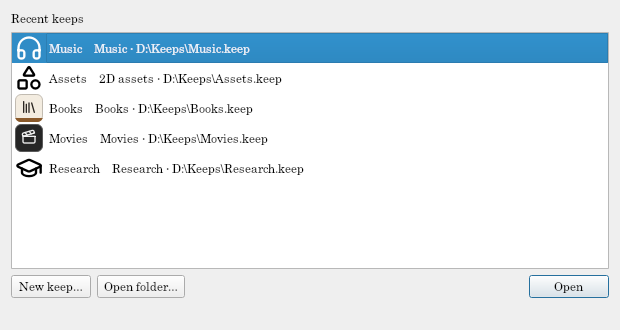

# Keeps and folders

## A keep

A keep is a folder ending in `.keep` that holds everything Tagalot knows about one collection:

```
Music.keep/
  keep.toml       what it is: its name, theme, and the folders it watches
  keep.db         its items, tags, and what it read from your files
  thumbs.db       thumbnails (can be deleted at any time; they're made again)
  fulltext.db     documents' text, when it searches inside documents
  ui_state.json   how you left its pages: layouts, columns, toggles
  backups/        copies made before Write to file… changed a file
  keep.db.v13-….bak   a copy made before an upgrade (one per upgrade)
```

- **Keep it on a local disk.** Its databases aren't reliable on a network share: Tagalot warns when you open a keep from one. Your files can be anywhere.
- **Move or copy it** like any folder (with Tagalot closed). It finds your files through the folders in `keep.toml`, by name, so a keep can travel between computers (see *On this computer*, below).
- **Keeps are independent.** One window per keep; open several at once.
- `keep.toml` is a text file you can read and edit. See [Keep files and settings](../reference/keep-files.md).

## Folders

A keep watches one or more **folders** (local, or on a network share: `\\nas\music`, a mapped drive, a mounted volume). Tagalot only ever reads them: it never writes, moves, renames, or deletes anything there (the one exception is [Write to file…](write-to-file.md), which you turn on folder by folder).

Add, rename, or remove folders in **Keep → Configure keep…** ([Keep configuration](keep-configuration.md)): **Add folder…** watches another folder and offers to scan it.

### Scanning

**Scan now** (F5) looks through every watched folder; a folder's own **Scan now** in Keep configuration scans just that one. A scan:

- reads new and changed files (by size and modification time; unchanged files aren't read again);
- notices **moved** files (same file, new place) and keeps their items and tags;
- marks files that are gone as **missing** (their items stay; see [Triage](triage.md) to clean up);
- leaves out files the folder's **Skip** patterns match.

Large folders and slow shares are fine: Tagalot reads in the background, and the window stays usable.

### Links: one file in several places

If you file things in several places with links, Tagalot treats each linked file or folder as **one item** that is in each place:

- **Symbolic links** (to a file or a folder), Windows **junctions** and **shortcuts** (`.lnk` files), and **hard links** are found by the scan and linked for you. A shortcut isn't listed as a file of its own: it's another place of the file or folder it leads to.
- The item is listed under each place's folder (an artist's, an author's), as it would be without the link, but only once in a search.
- Its tags, your edits, and its notes are shared, since it's one item.
- Its page lists the other places as **Also at …**, and opening it uses whichever place is there.
- A link to a folder brings everything in that folder along. A link back to a folder it's inside isn't followed, so a scan can't go round in circles.
- **Links outside the keep's folders:** the first scan that finds links to files or folders outside every watched folder asks once whether to include them. Included, what they lead to is read as if it were where the link is, as files of their own. Left out, they're skipped. **Keep configuration → Keep → Links outside** changes the answer.
- A link whose target is gone is left out.

Some shares (a Linux server's links seen from Windows, for example) show links as ordinary files and folders, so Tagalot can't tell they're links: they show up as identical files in [Duplicates](dedupe.md), where **Link as one** makes them one item, and **Linked folders** links two folders as one, with files that turn up in both later. **Unlink this place**, on an item's page, separates a place again.

### Offline folders

When a folder can't be reached (a share that's down, a drive that isn't plugged in), its files are marked **offline**: their items, tags, and thumbnails stay, and the dashboard and the Activity panel say so. Nothing is ever deleted because a folder was unreachable. Scan again once it's back.

### Not watching a folder

**Stop watching** (in Keep configuration) leaves a folder in the keep but stops scanning it; its items stay, shown offline. **Watch again** reconnects them.

**Remove…** asks what you want:

- **Stop watching it, and keep its items** (the safe choice), or
- **Delete its items from this keep**: the items whose files are all in that folder, with their tags, after a second confirmation. This can't be undone. Your files on disk are never touched.

### Skipping files

Each folder has a **Skip** list of patterns, one per line, for files to leave out: `**/Thumbs.db`, `**/Extras/**`, `Old/*.tmp`. New folders start with the usual operating-system and NAS leftovers (`.DS_Store`, `._*` files, `Thumbs.db`, `desktop.ini`, `$RECYCLE.BIN`, Synology's `@eaDir` and `#recycle`). A pattern can have a note after ` # ` saying why: `Exports/papers.bib # my export`.

Skipped files are left out at the next scan. An item whose files are all skipped is hidden from lists, searches, and the dashboard, but isn't deleted: it comes back with its tags if you remove the pattern. [Triage](triage.md)'s **Skip in scans…** adds a pattern for you.

### Reading inside archives

Tagalot can read the files inside archives (zip, 7z, rar) as files of their own, so a font in a zip becomes an item you can tag and find. It's off unless you choose it, because it means reading every archive:

- **A folder's archives:** in Keep configuration → Folders, **Read inside archives** takes patterns like the Skip box: `Fonts/**` for the archives under Fonts, `**` for every archive in the folder. On an item whose file is a folder, the right-click menu's **Read everything inside archives here** adds one for you.
- **One archive:** right-click it (its row in an item's Files section, or the item in a list, under **Inside the archive**): **Read everything inside** reads it all, those added later too; **Stop reading inside** reads nothing in it; **Choose what to read inside…** picks.

**Choose what to read inside…** lists the archive's folders and files. Click the × on a file to hide it, or on a folder to hide everything in it; hidden rows stay listed, struck through, until you click × again (or untick **Show hidden files** to tuck them away). The chips at the top hide or show every file of a type at once, and **Show all** and **Hide all** start from everything or nothing: to read just a few files, click **Hide all**, then the × on the few. Tick **Show thumbnails** to see the files as a grid of pictures (pictures, fonts, PDFs; others get a file icon) instead of the tree; click a picture to hide it or show it again. Pick how big the pictures are in the box beside it, or hold Ctrl and turn the mouse wheel over them. Tagalot remembers both for the keep. Files the keep's theme doesn't read aren't listed; the archive's name says which were left out. **Read these** saves your choice, and Tagalot reads the shown files in the background.

On a file inside an archive, **Hide inside its archive** hides just that one, from its item's page or from [Duplicates](dedupe.md). An archive read whole stays whole: files added to it later are still read.

Nothing is ever changed inside an archive. A hidden file's item is hidden with its tags kept, and comes back when you show the file again. [Triage](triage.md)'s **Skipped** tab lists what's hidden inside archives.

### On this computer

A keep may be opened on several computers that reach the same files by different paths (`\\nas\music` here, `/Volumes/music` there). **On this computer** (in Keep configuration, for each folder) sets this computer's path without changing the keep; it's saved in your own [settings](../reference/keep-files.md#settingstoml).

## Opening and upgrading

The launcher lists recent keeps (greyed when not found; right-click to remove one from the list, which doesn't touch the keep), each with its icon: its own (Keep configuration → Appearance), else its theme's. A keep with a color scheme shows its icon on the scheme's colors, with a stripe of its accent, and one that's always light or dark on a light or dark square, and its name in its titles font (its own, or the one its theme suggests), so you can tell your keeps apart before opening one.



A keep made by an older Tagalot is upgraded when you open it, after asking: `keep.db` is backed up first. An older Tagalot can't open a keep a newer one upgraded.
