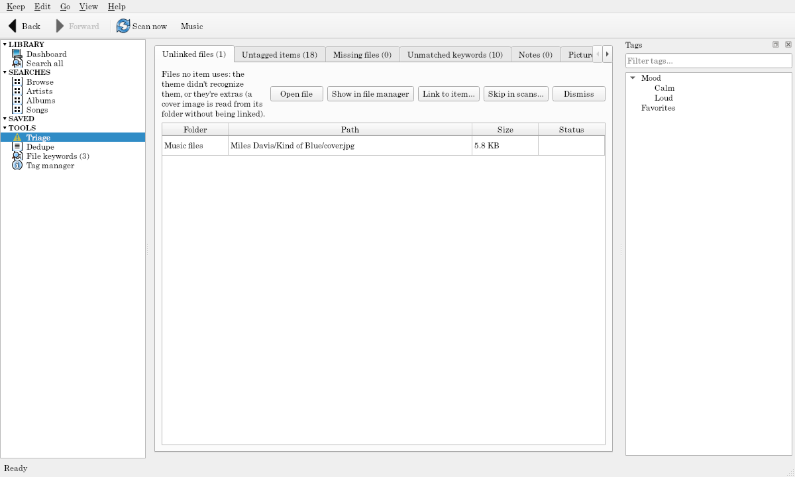

# Triage

TOOLS → **Triage** gathers what needs attention, in tabs with counts.

## Unlinked files

Files no item uses: a kind the theme doesn't recognize, extras (a movie's trailer), or a picture the theme read from its folder without linking. Select some, then:

- **Open file** or **Show in file manager** to see what they are.
- **Link to item…** links them to an item you pick, in a role that takes them (a cover, a supplement). A link you make by hand stays through scans, and the file's row on the item's page says "linked by you" (right-click it to unlink).
- **Skip in scans…** adds an exact pattern for each file to its folder's Skip list (with a note saying Triage did it); the next scan leaves them out.
- **Dismiss** hides them from this list until they change.

## Untagged items

Items with no tag of their own (or, with Inherit tags on, none from what holds them either). It's an ordinary search page: tag from the Tags panel, by drag and drop, or with Ctrl+T, and they leave the list. **Dismiss** hides items you mean to leave untagged, until they change.

## Missing files

Items whose files are all gone (missing, not just offline). **Show where they were** opens the folder the first file was in. **Delete…** deletes the items and their tags from the keep (after asking; it can be undone). Files on disk are never touched. Both are also in the right-click menu of an item in the list (as **Delete…** and **Show where it was**); with several items selected, Delete… deletes them all.

## Unmatched keywords

Items whose files give [keywords](file-keywords.md) that match no tag, with a **Keywords** column. A button opens the File keywords page to map or ignore them.

## Markdown

Markdown files that need attention, each with why:

- **Notes** in the [notes folder](notes.md#the-notes-folder) that aren't an item's note: no item has its title or aliases; several items match (add `tagalot-type`, or an alias only one of them has); or the item it matches has another note.
- **Front matter that gives a key twice:** `` `universe` is given twice (lines 7 and 21); the last, '', is used.`` Only one value can count, and Tagalot uses the last, so a forgotten empty `universe:` further down hides the one you meant. Keys that differ only in case (`Title` and `title`) count as twice too, since Tagalot reads them as one key.
- **Front matter that doesn't parse**, with where it goes wrong (`expected ',' or ']'… (line 4)`). Tagalot reads the rest of the file as if it had no front matter.

**Open file** opens it in your Markdown editor to fix it, and **Show in file manager** shows it in its folder. A file is checked whenever a scan reads it (when it's new or changed), so the list updates at the next scan after you fix it.

## Pictures

Items whose pictures are missing or broken:

- **Not found:** a picture an item's file names that isn't there, such as a Markdown book's `cover`. Select the row to see what the file says and each place Tagalot looked, in order (beside the file, then the [assets folders](../themes/books.md)), with what is there now: not there, on disk but not scanned yet, skipped by the folder's settings, offline, or here now. Fix the name in the file, put the picture in one of those places, or set an assets folder. Then **Re-read from file**, or scan again for a picture you added. A cover that's a web address is listed too: Tagalot only shows pictures in your folders.
- **Can't be drawn:** a picture an item has that is damaged or in a format Tagalot can't read, with the error. It shows up once Tagalot has tried to draw it (in a grid or on a page), and goes away when the file changes.

**Open page** opens the item, and **Show the file** shows the file that names the picture (or the broken picture) in your file manager.

**Ignore** leaves the selected rows off the list:

- **For this item**: until the file names something else, or the broken picture changes.
- **"TBD" in every file**: any item whose file names that value (case aside). Handy for a placeholder your template writes.
- **Every Book** (or whichever type): no picture problems are listed for that type.

Each is a step you can undo. Tick **Show ignored** to see ignored rows (greyed, saying how), and **Stop ignoring** to list one again. Placeholders such as `cover: None`, `null`, `N/A`, or `-` already mean "no cover", so they're never listed.

## New in archives

Archives you chose to read file by file (with **Choose what to read inside…**, see [Reading inside archives](keeps-and-folders.md#reading-inside-archives)) that have gained files since: a newer version of a font pack with new fonts, say. Tagalot doesn't read new files in them until you decide. Each archive is listed with how many files are new and of which kinds ("3 new: .otf, .ttf"), the most recently changed first.

- **Review…** (or a double-click) opens Choose what to read inside… on the archive. Its new files are in bold, marked **(new)**, and start hidden: show the ones you want, then **Read these**. The rest are recorded as hidden, and the archive leaves the list.
- **Hide all new** hides the selected archives' new files without opening anything. Choose what to read inside… shows them again.

Archives read whole (a folder's **Read inside archives** pattern, or **Read everything inside**) aren't listed: their new files are simply read. The dashboard's Untagged card says when archives have new files, with a link here.

## Skipped

Files scans leave out, grouped by the rule that leaves them out, with how many files each rule skips and how many items it hides. An item whose files are all skipped is hidden from lists and searches until one of its files is read again; its tags are kept.

- **Skip pattern “`Drafts/**`”**: a pattern in a folder's **Skip** box ([Keep configuration](keeps-and-folders.md#skipping-files)), or one **Skip in scans…** added. A file under two patterns is listed under both.
- **Not a note in the notes folder**: the [notes folder](notes.md#the-notes-folder) keeps only notes, pictures, and archives.
- **The theme doesn't read .bmp**, **Folders the theme doesn't record**: files the keep's theme leaves out. Another theme, or a newer version of it, may read them.
- Inside archives: **Not read inside archives**, **Archives turned off**, **Hidden inside archives**, and **Inside skipped archives**. An archive's right-click menu changes what's read inside it ([Reading inside archives](keeps-and-folders.md#reading-inside-archives)).
- **Read again at the next scan**: no rule leaves these out any more (you removed the pattern), so the next scan reads them.

Select a rule to list its files and see where the rule lives. To read the files again, change it there, then scan.

## Links

**Broken links:** symbolic links, junctions, and shortcuts whose target is gone (deleted, renamed, moved, or on a drive that isn't connected), with where they pointed ("Broken: pointed to D:\Books\x.pdf"). **Show in file manager** shows the link itself, so you can fix it or delete it. A scan that finds its target again clears it.

**Files that differ:** files in [linked folders](dedupe.md#linked-folders) that differ from the file at the same path in the folder they're linked with, so they aren't linked: one may have been edited, or be a copy. **Open file** and **Show in file manager** act on the file, **Open the other** on the one it differs from. Make them the same on disk (or remove the one you don't want), and the next scan links them.

Dismissing and deleting are steps you can undo. The lists update after every scan, tagging, or change.
