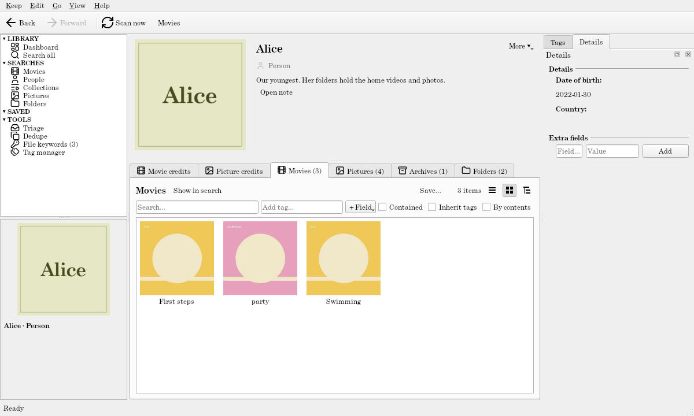

# Movies

For video files named the way Plex, Kodi, and Jellyfin like them: **collections** ⊃ **movies**, and the **people** in them. Home videos work too, with the pictures beside them.

## What it makes

- **Movie:** from a video's name (`Inception (2010)`, `Blade Runner [1982]`, `The.Matrix.1999.1080p.BluRay`). Videos side by side whose names differ only by a part, quality, or edition (`- 720p`, `cd2`, `part1`, `- Extended`) are one movie with several files. A folder named like a movie (`Inception (2010)/`), or whose videos are all one movie, is that movie's folder.
- **Extras aren't movies:** names ending `-trailer`, `-sample`, `-featurette`, `-behindthescenes`, `-deleted`, `-interview`, `-scene`, `-short`, `-other`, and videos in `Extras`, `Featurettes`, `Trailers`, `Behind The Scenes`, and similar folders. [Triage](../guide/triage.md) lists them; **Skip in scans** hides them.
- **Video details** (read with MediaInfo): length, resolution, quality (`4K`, `1440p`, `1080p`, `720p`, `SD`), video codec, and audio languages. A movie with several versions shows its best.
- **`.nfo` files** (`movie.nfo`, or named like the video): title, year, plot, genre, director, length, and rating (out of 10, shown as five stars: 7 is ★★★½☆), which win over the file name; the **IMDb ID** and **TMDb ID** (from `<uniqueid>`, `<imdbid>`, `<tmdbid>`, or `<id>`; you can type them in too); the **cast** in order; and a **set**, which becomes a collection.
- **Collection:** a folder holding two or more movies' folders, or a set, from an `.nfo`'s `<set>` or a note's `set`.
- **Person:** actors from `.nfo` casts or a note's `cast`, and anyone you add by hand or a folder's note names, such as the family in your home videos (see [People](#people)). Their photo is Kodi's `.actors/First_Last.jpg`; without one, a **title card** with their name.
- **Folder:** a folder with pictures or archives in it, or below it, holds what's there: movies, pictures, archives, and the folders inside. Tag `Home Movies/Alice`, and her videos and photos all count as tagged (see [Folders](#folders)).
- **Picture** and **Archive:** every other picture, and every zip, 7z, or rar archive, is an item of its own that you can tag and search, such as the family pictures beside your home videos (see [Pictures](#pictures)).

## Details from TMDb

With a TMDb key, a movies keep can look movies up in [TMDb](https://www.themoviedb.org) (see [Online details](../guide/online-details.md)). Get a free API Read Access Token from your TMDb account's API settings, then in **Keep → Configure keep… → Keep** tab, under **Environment**, select `TAGALOT_TMDB_TOKEN` and click **Set…**. Tagalot then asks once whether to look things up.

- **How a movie is found:** by its **TMDb ID**, else its **IMDb ID** (from its `.nfo`, or typed in). A movie with neither is found by its title (and year) only if the keep's **Find items by** allows it; by default it isn't sent. A title only counts when TMDb has a movie of that very title, or with it after a colon (*The Lord of the Rings: The Fellowship of the Ring*), and the same year.
- **Details:** the plot, genres, director, length, and rating fill in what the files don't say; an `.nfo`'s values, a note's, and yours always win. Without an `.nfo`, TMDb's title and year replace what the file name suggested (`The.Matrix.1999.1080p` becomes *The Matrix*).
- **Poster:** for a movie with no poster of its own. It shows ahead of the movie's screenshots and its folder's picture, but a poster file of your own (`poster.jpg`, `Heat (1995)-poster.jpg`…) always wins.
- **Cast:** a movie with no cast (no `.nfo` cast, nobody added by hand) gets TMDb's top 10 billed. People in a movie's cast with no photo of their own get TMDb's.

Everything fetched is kept in the keep, never put in your folders.

## Notes

A [note](../guide/notes.md) inside a movie's own folder (`Inception (2010)/Inception (2010).md`, or `index.md`, or `README.md`) describes the movie: fields an `.nfo` doesn't give (the `.nfo` wins when it does), `tags`, anything else as Extra fields, and a description shown on its page. A collection's folder note describes the collection.

**Loose videos** (several movies side by side in one folder) take a note named like the video, as an `.nfo` can be: `Heat (1995).md` beside `Heat (1995).mkv` (or `Heat (1995) - 720p.mkv`, any of its versions). It works as a folder's note does, and its `title` also renames the movie. A Markdown file named for no video there is left alone, listed under [Triage → Unlinked files](../guide/triage.md#unlinked-files) like a stray `.nfo`; the folder's own note (`Misc/Misc.md`) still describes the Folder.

```
Home Movies/
  Heat (1995).mkv
  Heat (1995).md        ← Heat's note
  birthday.mp4
  birthday.md           ← birthday's note
```

**Cast and set from a note:** a movie's note (either kind) can give `cast: [Al Pacino, Robert De Niro]` and `set: Heist Films`, as an `.nfo`'s `<actor>`s and `<set>` do. The people are found or made (one person per name, shared with `.nfo` casts), and the movie goes into that set. Change the note and the cast and set follow: a name you remove leaves the cast, and a new set takes the movie from the old one. An `.nfo` that names a cast or a set wins over the note's; one that names none leaves the note's alone. Separate names with `;` instead when a name has a comma in it.

**Runtime in a note** reads as people write it: `runtime: 1:35:00` (hours, minutes, seconds), `1h 35m`, `95 min`, or just `95`, which is minutes, as in an `.nfo`. `23:45` is 23 minutes 45 seconds. Typing a Runtime on the movie's page works the same way.

A movie's page shows them as **Cast** and **Set** among its details, and you can type there too: names you type become the cast, or the set, by hand. Typing a **Set** takes the movie out of every other collection, a folder's included.

In a movie's own folder, its note is the folder's (`Inception (2010)/Inception (2010).md`), not one named like a video there, and it doesn't rename the movie: the folder's note also describes the Folder.

People have no folder of their own: their notes go in the keep's [notes folder](../guide/notes.md#the-notes-folder), as `Notes/People/Sigourney Weaver.md` (or `Notes/Actors/…`, as before, or anywhere in it with `tagalot-type: person`), and can give a `born` date and `country`.

## Pictures

In a movie's folder, its **poster** is `poster.jpg` (or `folder`, `cover`, `movie`, `default`, or a picture named like the movie); its other pictures, and those in `screenshots`, `extrafanart`, `backdrops`… subfolders, are its **screenshots**. Beside loose videos, `Heat (1995)-poster.jpg` is that movie's poster and `-fanart`, `-landscape`, `-thumb`, `-banner` pictures are screenshots. A movie with neither shows its folder's picture (`folder.jpg`, `cover.jpg`), so home videos sharing a folder share its look (in the demo, Alice's *First steps* and *Swimming*), and only a video with none of these shows the video icon.

Every picture that isn't a poster, an actor's photo, or Kodi's artwork is also a **Picture** of its own, and every archive an **Archive**. Kodi's artwork is a picture in an `extrafanart`, `backdrops`, or `.actors` folder, or, in a movie's folder, one named `fanart`, `banner`, `clearlogo`, `landscape`, `thumb`, `disc`, `logo`, and the like. A folder's own picture, such as `folder.jpg` or `cover.jpg` (names Explorer and music players use for a folder's look), is never a Picture: it's the Folder's thumbnail. So in `Alice/3rd Birthday/` with one video, the photos are the movie's screenshots and Pictures too. A Picture's **Date** is when it was taken (its EXIF), or the file's date when that is older or there is none. An archive's is the oldest date among its first 10 files, or its own if that's older, since an archive is often much newer than the pictures in it. You can change a date by hand, and scans keep your change.

A movie's page shows its screenshots as a [gallery](../guide/item-pages.md#galleries): also every picture under a `Screenshots`, `Screens`, or `Stills` folder at any depth, and archives named like them (`Screens.zip`). A person's **Photos** gallery comes from the notes folder: `Notes/People/Al Pacino/` beside `Al Pacino.md`.

## Folders

Every folder above a Picture or Archive becomes a **Folder**, up to the top of the watched folder. A movie's own folder counts too: `Alice/3rd Birthday/`, with one video and some photos, is a Folder holding the movie and its photos, and tagging it tags both. So is a `Screenshots` folder with pictures in it. A collection's folder isn't a Folder, because the collection already holds its movies.

Each Folder holds what's nearest under it, so `Home Movies` holds `Alice`, which holds `3rd Birthday`. A video in a folder with no pictures (`Home Movies/Bob/swim.mp4`) is held by the nearest Folder above it. Folders are worked out again after every scan: add a picture to a folder and it becomes a Folder holding the videos already there. A Folder whose pictures are all gone is removed at the next scan, unless you've tagged it.

A Folder takes the [note](../guide/notes.md) inside it (`Alice/Alice.md`, or `index.md` or `README.md`), as an album or collection does: its `title` renames the Folder, its `tags` tag it (and so everything in it), its other keys become Extra fields, and its text shows on the Folder's page. In a movie's own folder, the movie reads the same note, so `3rd Birthday/3rd Birthday.md` describes both the Folder and the movie (the movie keeps its own title).

### See-through folders

If your folders each have a folder just for Explorer's sake, such as `! Posters` with a movie's posters and notes, list its name under **See-through folders** in the keep's settings ([Keep tab](../guide/keep-configuration.md#keep)). Such a folder is never a Folder, and its files count as its parent's:

- `Heat (1995)/! Posters/poster.jpg` is Heat's poster, and other pictures there are its screenshots. A `movie.nfo` there is Heat's too.
- `3rd Birthday/! Posters/folder.jpg` is the `3rd Birthday` Folder's thumbnail, and its other pictures are among that Folder's contents.
- A note there named for the parent (`3rd Birthday/! Posters/3rd Birthday.md`) is the parent's note.

In the movies demo, The Return of the King's poster is in its `! Posters` folder.

## People

Actors are **People** now, so the family in your home videos can be people too.



- **Named by a folder's note:** `Home Movies/Alice/Alice.md` with `people: [Alice]` (several: `people: [Alice, Grandma]`) makes the person Alice, or finds her (by name, as an `.nfo`'s cast does). Alice then holds that Folder. Her page lists everything under it: videos, pictures, archives, and folders. **Within** Alice searches it, and a tag on Alice counts for all of it in the Movies and Pictures views. A folder can be held by several people, and a person dropped from the note lets go of it at the next scan.

  The folder's note describes the **Folder**, not Alice: its title, body, and any other keys (a `born:` date, say) are the Folder's, and `tagalot-type` doesn't change that. Alice's own details go in her note in the notes folder, `Notes/People/Alice.md` (or `Notes/Actors/Alice.md`), as for any person. See [Notes: where a note goes](../guide/notes.md#where-a-note-goes).
- **In movies:** a movie's page has **Cast**, a person's **Movie credits**: both with **Add…** (search for a person or movie, or make a new person) and **Remove from …**.
- **In pictures:** a picture's page has **People**, a person's **Picture credits**, with **Add…** and **Remove from …** the same way.

What you add or remove by hand stays through later scans, whatever the `.nfo` or a note says. A person's page keeps them apart: **Movie credits** and **Picture credits** are what you or the `.nfo` linked them to, and the **Movies**, **Pictures**, and **Folders** tabs are what's under the folders they hold.

## Searches

All grids, sorted by title: **Movies** (inheriting tags: tag a collection `Fantasy` and its movies match), **People**, and **Collections**; **Pictures** (pictures and archives, oldest first) and **Folders**, which, like Movies, count a folder's tags for what's in it. Movie cards show the year and quality; a collection lists its movies by year.

## Genres as tags

The `.nfo`'s genres are [file keywords](../guide/file-keywords.md).

## Fonts

Titles suggest Oswald, a narrow poster face (else Arial Narrow). Keep configuration's [Appearance](../guide/keep-configuration.md#appearance) tab offers to download a suggested Google Font that isn't on your computer, and you can choose your own instead.
