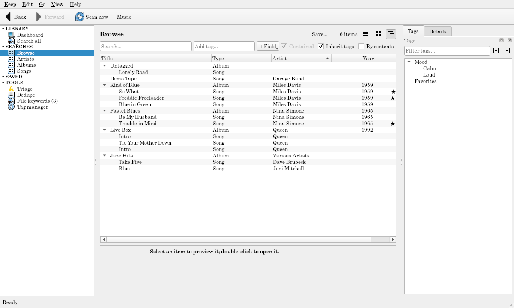

# Music

For audio files with tags: **artists** ⊃ **albums** ⊃ **songs**.

## What it makes

- **Album:** a folder with audio in it. Disc folders (`CD1`, `Disc 2`, `Disk-3`) belong to their parent's album and give their songs a disc number. It's titled from its songs' album tag (else the folder name), with their year and genre.
- **Song:** from the file's tags (title, track, disc, artist, album artist, album, year, genre, length, bitrate). Songs with the same album, disc, track, and title are one song whose files are its **versions** (`01 So What.flac` and `01 So What.mp3`). A file without tags is named from its file name (`01 - So What.mp3`: track 1, "So What").
- **Rating:** songs and albums have a **Rating**, five stars with halves. A song's starts from its file's rating when it has one (as Windows Media Player, foobar2000, MusicBee, and others write it); an album's is yours. Once you rate one, yours stays.
- **Artist:** an album's artist is its songs' album artist (else their artist); when they disagree, it's **Various Artists** (a compilation). A song by someone other than its album's artist is also under its own artist.
- Formats: MP3, FLAC, Ogg, Opus, M4A/AAC, WAV, WMA, AIFF.

## Notes

An album's folder can hold a [note](../guide/notes.md) named after it (`Queen/Live Box/Live Box.md`): a `year` or `genre` its songs' tags don't give (the tags win when they do), `tags`, anything else as Extra fields, and a description shown on the album's page. Artists have no folder of their own: their notes go in the keep's [notes folder](../guide/notes.md#the-notes-folder).

## Playing

Double-click (or Enter) on a song **plays** its first version that's on this computer; Ctrl+Enter opens its page. **Play album** (on an album's menu or page) makes a playlist of its songs in order and opens it with your player.

## Searches

- **Browse:** albums and songs as a tree, by artist, year, and title, with each album's songs under it.
- **Artists** (grid), **Albums** (grid, by artist, year, title), and **Songs** (list, by artist, album, disc, track, title).

The album and song searches inherit tags: tag an album `Live`, and its songs match `Live`.

## Thumbnails

A song shows its embedded cover art, else its album's. An album shows the picture in its folder (`folder.jpg`, `cover.jpg`, `front.png`, `AlbumArt…`), else its songs' embedded art. An artist shows its first photo, else one of its albums', else a **title card** with its name.

An album's page has a **Scans** [gallery](../guide/item-pages.md#galleries): the pictures under a `Scans`, `Artwork`, `Covers`, or `Booklet` folder in its folder, and archives named like them (`Booklet.zip`). An artist's **Photos** come from the notes folder, beside its note.

## Genres as tags

Every genre a song's tags give (several, or one like `Pop/Rock`) is a [file keyword](../guide/file-keywords.md): it becomes your tag when it matches one. The Genre field keeps the text as the files give it.

## Dashboard and duplicates

Total running time, the average song, top genres, and top years. Songs with the same artist and title and about the same length are listed as similar items (two songs on one album never are).
